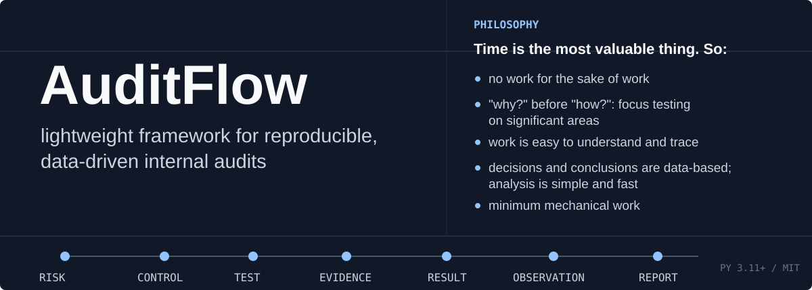
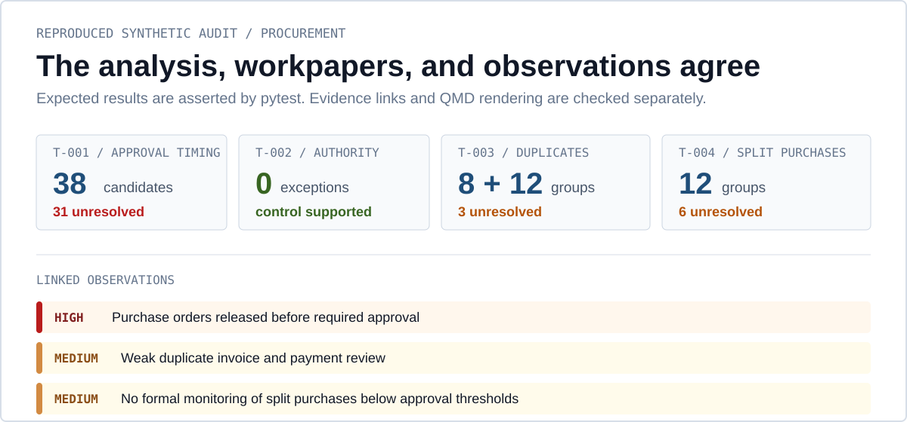
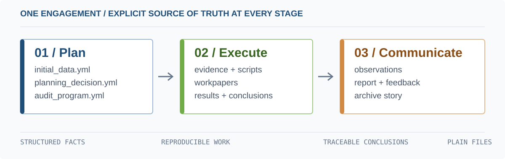

AuditFlow turns internal audit engagement into a transparent project of structured
files, reproducible analysis, linked evidence, workpapers, observations, and reports.
It is intended for auditors who want more control than a folder of Word and Excel files
without introducing a large workflow system.

> **AuditFlow** does not replace TeamMate, AuditBoard, Pentana, or company systems for portfolio management.

## See it work

The repository includes a complete synthetic procurement audit. Its analysis is executed
in the test suite, its evidence links are validated, and its seven QMD documents are
rendered in the Quarto integration test.



| Reproduced test result | Result |
| --- | ---: |
| Purchase orders released before approval | 38 candidates, 31 unresolved |
| Approval authority exceptions | 0 |
| Duplicate invoice and payment indicators | 8 invoice groups, 12 payment groups, 3 unresolved |
| Split-purchase indicators | 12 candidate groups, 6 unresolved |

Explore the
[analysis script](./examples/procurement_audit/04_evidence/02_raw_data/scripts/procurement_analysis.py),
[workpapers](./examples/procurement_audit/05_workpapers), and
[generated report](./examples/procurement_audit/07_reporting/report.qmd).

## Start with the example

Requirements: Python 3.11+ and [Quarto](https://quarto.org/) for QMD preview and rendering.

```bash
git clone https://github.com/Kirk-KV/auditflow.git
cd auditflow
pip install -e ".[analysis]"

cd examples/procurement_audit
auditflow status
auditflow validate
quarto preview 07_reporting/report.qmd
```

The analysis extra installs the Python dependencies used by the bundled example. Quarto is
a separate application and must be available as `quarto` on `PATH`.

Create a new audit project:

```bash
auditflow init "C:/Audits/2026-001_procurement"
cd "C:/Audits/2026-001_procurement"
auditflow status
```

AuditFlow creates the staged workspace. The auditor edits its YAML and QMD files between
commands. Follow the [user journey](./docs/user_journey.md) for the complete first audit.

## How it works



```text
Risk -> Control -> Test -> Evidence -> Result -> Observation -> Action -> Report
```

The workflow is decision-oriented rather than form-oriented:

1. Planning identifies what matters and why.
2. The audit program connects significant risks, controls, and planned tests.
3. Workpapers document the procedure, linked evidence, result, and conclusion.
4. Observations are generated only from explicit workpaper proposals.
5. Reports and the archive are rebuilt from structured source artifacts.

Common commands:

```bash
auditflow create planning
auditflow create audit-program
auditflow create workpapers
auditflow create observations
auditflow create report
auditflow validate
```

Use `auditflow validate` during drafting and `auditflow validate --strict` before sharing
final materials. Validation checks structural integrity and traceability; it does not
provide an automated opinion on audit quality.

QMD documents can be previewed repeatedly with the Quarto extension in VS Code or
`quarto preview`. Batch rendering is a finalization convenience, not a replacement for
previewing workpapers and reports while they are being developed.

## Plain files, explicit relationships

AuditFlow keeps each engagement inspectable without a database or proprietary file format:

- **YAML** holds structured audit facts and relationships.
- **QMD / Markdown** holds narratives, professional judgment, and conclusions.
- **Python / SQL** keeps data analysis reproducible.
- **Quarto** previews and renders workpapers and reports.
- **Git**, when used, provides version history and manager review.

The core model stays deliberately small. Companies can extend schemas, templates,
validation rules, styling, and review processes without making enterprise governance
fields mandatory for every user. See the
[project structure](./docs/project_structure.md),
[workflow](./docs/workflow.md), and
[customization guide](./docs/customization.md).

## Traceable evidence

Raw evidence is ignored by Git by default and generated outputs are stored separately.
Workpapers use ordinary Markdown links to the local files supporting their conclusions:

```markdown
[Test output](../04_evidence/99_generated/T001_result.csv)
```

`auditflow validate` checks those local links together with schemas, IDs, and artifact
relationships. Teams that need change detection can also maintain a SHA-256 manifest:

```bash
auditflow evidence refresh
auditflow evidence status
```

A fingerprint detects a local file change. It does not prove provenance, completeness, or
authenticity and does not replace secure evidence storage. See
[reproducible data analysis](./docs/data_analysis.md) for the working conventions.

## Optional AI

AI assistance is disabled by default. The implemented runtime adapter uses
[Ollama](https://ollama.com/); Qwen3 8B is the demonstration model, not a framework
requirement.

```bash
ollama pull qwen3:8b
auditflow ai review-audit-program --dry-run
auditflow ai draft-observation WP-C-001 --dry-run
auditflow ai review-observation OBS-001 --dry-run
```

AI tasks receive selective context and write responses to separate sidecar files. Raw
evidence is excluded by default, and company policy controls approved providers,
destinations, models, classifications, confirmation, and retention. Model comments remain
advisory. See [LLM integration](./docs/llm_integration.md) for setup and the security model.

## Optional Git review

AuditFlow works without Git. A team that needs version history and manager approval can
store the same plain-file project in a private GitLab, Azure DevOps, GitHub Enterprise, or
another approved service. Protected branches and pull or merge requests then provide
comments, approvals, and safe reverts without changing the AuditFlow core.

Raw evidence remains outside the repository; only approved source artifacts and, when
used, the evidence manifest are versioned. See
[Git collaboration](./docs/git_collaboration.md) for the concise setup.

## Scope

AuditFlow is currently an alpha-stage engagement framework. It is best suited to an auditor or a small team working on data-heavy audits.

Current boundaries:

- validation checks structure and traceability, not evidence sufficiency or conclusion quality;
- long-term action tracking is outside the scope at the moment (should remain in a company system);
- access control and electronic sign-off are not part of the model;
- Ollama is the only implemented AI provider adapter, I'll add more later;
- sensitive-data scanning is pattern-based and cannot prove that a prompt is safe.

These boundaries keep the default workflow lightweight. They do not prevent a company
from adding stricter schemas, controls, templates, or review requirements.

## Documentation

- [User journey](./docs/user_journey.md)
- [Audit workflow](./docs/workflow.md)
- [Methodology principles](./docs/methodology.md)
- [Project structure](./docs/project_structure.md)
- [Reproducible data analysis](./docs/data_analysis.md)
- [VS Code and CLI](./docs/vscode_cli.md)
- [Customization](./docs/customization.md)
- [LLM integration](./docs/llm_integration.md)
- [Git collaboration](./docs/git_collaboration.md)

## Development

```bash
pip install -e ".[analysis,test]"
python -m pytest -q
```

Contributions should preserve the separation between source evidence and generated output,
keep examples synthetic, and update documentation when commands or source-of-truth files
change. See [CONTRIBUTING.md](./CONTRIBUTING.md).

AuditFlow is released under the [MIT License](./LICENSE).
