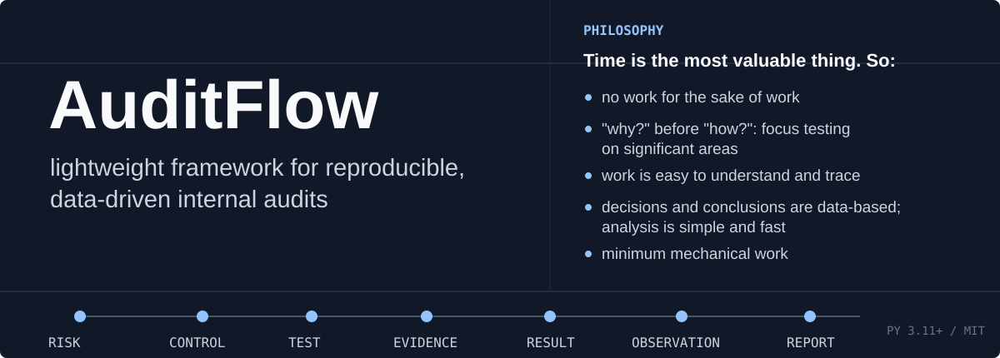

[English](./README.md) | **Русский**

AuditFlow организует отдельный аудит как прозрачный проект из структурированных файлов, воспроизводимого анализа, связанных доказательств, рабочих документов, наблюдений и отчета.

> AuditFlow не претендует на замену TeamMate, AuditBoard, Pentana и корпоративные системы управления портфелем аудитов.

## Быстрый старт

Требования: Python 3.11+ и [Quarto](https://quarto.org/) для просмотра и рендеринга QMD.

```powershell
git clone https://github.com/Kirk-KV/auditflow.git
cd auditflow
pip install -e ".[analysis]"

auditflow init "C:/Audits/2026-001_procurement" --language ru
cd "C:/Audits/2026-001_procurement"
auditflow status
```

Язык выбирается один раз при создании проекта и сохраняется в `00_admin/settings.yml`. Если параметр не указан, используются английские шаблоны.

```yaml
language: ru
```

YAML-ключи, идентификаторы, статусы, имена каталогов и CLI-команды остаются английскими. На русском создаются заголовки, инструкции и подписи в документах.

> Более полные/ подробные описания - в английских версиях документов. Если что-то осталось неясным - посмотрите туда, или пишите в discussions на github.

## Как устроена работа

```text
Risk -> Control -> Test -> Evidence -> Result -> Observation -> Action -> Report
```

1. Аудитор заполняет исходные данные и параметры проекта.
2. Планирование определяет существенные риски и периметр.
3. Программа связывает риски, контроли и тесты.
4. Рабочие документы фиксируют выполненную работу, доказательства, результаты и выводы.
5. Наблюдения создаются только из явных предложений в рабочих документах.
6. Отчет и архив пересобираются из структурированных материалов проекта.

Основные команды:

```powershell
auditflow create planning
auditflow create audit-program
auditflow create workpapers
auditflow create observations
auditflow create report
auditflow feedback request
auditflow feedback summary
auditflow create archive
auditflow validate
```

`auditflow validate` проверяет структуру и прослеживаемость. Он не подтверждает качество доказательств, профессиональное суждение аудитора или обоснованность итогового вывода.

## Опциональный AI

AI-проверки по умолчанию отключены. AuditFlow поддерживает локальный Qwen через Ollama, OpenAI-совместимые API и Anthropic Claude. 
Внешние провайдеры доступны только через корпоративную политику, которая задает разрешенные endpoint, модели, классификации данных и переменные окружения с API-ключами.

```powershell
auditflow ai status
auditflow ai review-audit-program --dry-run
auditflow ai draft-observation WP-C-001 --dry-run
auditflow ai review-observation OBS-001 --dry-run
```

Результат AI сохраняется отдельно и не изменяет исходные документы автоматически.
Настройка и правила безопасности описаны в разделе [Использование LLM](./docs/ru/llm_integration.md).

## Синтетический пример

Репозиторий содержит полный синтетический аудит закупок. Он оставлен на английском, но суть передаёт.

- [скрипт анализа](./examples/procurement_audit/04_evidence/02_raw_data/scripts/procurement_analysis.py);
- [рабочие документы](./examples/procurement_audit/05_workpapers);
- [отчет](./examples/procurement_audit/07_reporting/report.qmd).

## Что входит в рамки AuditFlow

AuditFlow предоставляет:

- понятную структуру отдельного аудита;
- воспроизводимый анализ на Python, SQL и Quarto;
- связи между программой, рабочими документами, доказательствами и наблюдениями;
- опциональные Git review и AI-проверки.

AuditFlow намеренно не реализует портфельное планирование, разграничение доступа, электронные согласования и долгосрочный action tracking. Это пока процессы корпоративных систем.

Структура проектов, созданных через AuditFlow позволяет очень бытро и относительно легко подстраивать аудиты под требования конкретной компании, делать своды и иную статистику по проектам, расширенно использовать корпоративный ИИ, добавлять необходимые модули и обработки, что неиллюзорно упрощает существование относительно "вещей в себе" типа TeamMate.  

## Документация

- [Начало работы](./docs/ru/user_journey.md)
- [Процесс аудита](./docs/ru/workflow.md)
- [Методологические принципы](./docs/ru/methodology.md)
- [Структура проекта](./docs/ru/project_structure.md)
- [Анализ данных](./docs/ru/data_analysis.md)
- [VS Code и CLI](./docs/ru/vscode_cli.md)
- [Настройка](./docs/ru/customization.md)
- [Использование LLM](./docs/ru/llm_integration.md)
- [Совместная работа через Git](./docs/ru/git_collaboration.md)

AuditFlow распространяется по [лицензии MIT](./LICENSE).
